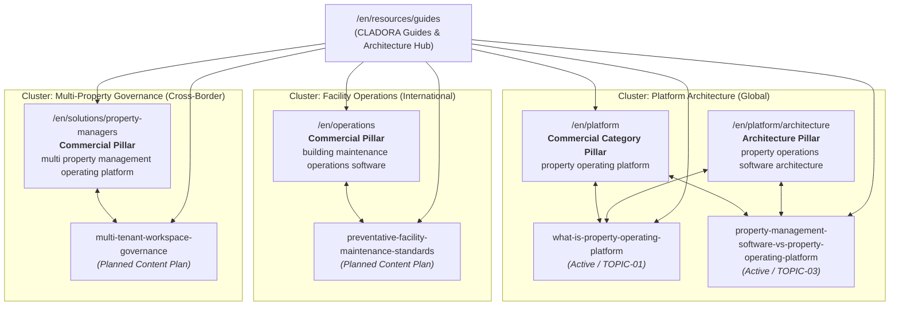

# CLADORA — English (EN) International Keyword-to-Intent Master Map
## Document Version: 1.0 (WP-15B International Scope)
## Target Language: English (en) — Global / International Audience
## Core Principle: Locale ≠ Jurisdiction (Zero Hypothetical Country Assumption)
## Governance Status: Approved for Implementation

---

## 1. Positioning & Audience Definition

CLADORA's English-language web surface is built exclusively for an **international, multi-jurisdiction audience**:
- **Target Persona 1: Cross-Border Asset Managers & Family Offices**: Institutional and private investors managing real estate across multiple national boundaries without wanting data fragmented into country-specific siloes.
- **Target Persona 2: Enterprise Facility & Property Operations Directors**: Professionals seeking rigorous operational frameworks (preventative maintenance, equipment registries, work order dispatch) rooted in universal engineering principles rather than local municipal forms.
- **Target Persona 3: PropTech Architects & System Evaluators**: Technical evaluators comparing monolithic legacy PMS with decoupled operating platforms, focusing on property identity, workspace boundaries, and canonical data providers.

### Strategic Safeguard:
Under no circumstances shall English guides assume a single hypothetical jurisdiction (such as US HOA law or UK leasehold reform). In production, Country Pack runtime is `NOT_ACTIVE` and remote activation is `NOT_RUN_NOT_PASS`. Requirements of the asset's location country must be verified independently with current sources and qualified professional review; guides do not announce an active Country Pack or production legal compliance.

---

## 2. Keyword-to-Intent Master Matrix (English International)

| Primary Query | Secondary Queries | Search Intent | Owner URL | Supporting Guides | Funnel Stage | Target Persona | Cannibalization Exclusions |
| :--- | :--- | :--- | :--- | :--- | :--- | :--- | :--- |
| `property operating platform` | building operating platform, real estate operating system, property operations software | Commercial / Category Evaluation | `/en/platform` | `what-is-property-operating-platform`, `property-management-software-vs-property-operating-platform` | MOFU / BOFU | PropTech Architects, Asset Managers | Informational guides explain architectural concepts; commercial landing page owns the category commercial intent |
| `property management software vs operating platform` | monolithic PMS vs operating platform, real estate software architecture comparison | Informational / Architectural Analysis | `/en/resources/guides/property-management-software-vs-property-operating-platform` | `/en/platform`, `/en/platform/architecture` | TOFU / MOFU | System Evaluators, CTOs | Focuses strictly on technical data models and decoupling; points to `/en/platform` for platform onboarding |
| `what is a property operating platform` | property operating platform architecture, canonical real estate data model | Informational / Category Education | `/en/resources/guides/what-is-property-operating-platform` | `/en/platform`, `/en/platform/architecture`, `/en/platform/lifecycle` | TOFU | Real Estate Executives, Evaluators | Pure educational definition and 6-layer conceptual breakdown; does not compete on commercial software queries |
| `property operations software architecture` | decoupled real estate data model, canonical property domain providers | Informational / Architectural Deep Dive | `/en/platform/architecture` | `what-is-property-operating-platform`, `property-management-software-vs-property-operating-platform` | MOFU | System Architects, Enterprise IT | Owns system-level architectural specifications across CORE, FIN01, DOCUMENTS, OPERATIONS, SERVICE |
| `building maintenance operations software` | facility maintenance work orders, preventive maintenance software, equipment asset register | Commercial / Solution Evaluation | `/en/operations` | Planned Guide: `preventative-facility-maintenance-standards` | MOFU / BOFU | Facility Managers, Operations Directors | Dedicated solution pillar for work-order dispatch, asset registries, and maintenance logbooks |
| `multi property management operating platform` | multi tenant workspace governance, cross border property management software | Commercial / Solution Evaluation | `/en/solutions/property-managers` | Planned Guide: `multi-tenant-workspace-governance` | MOFU / BOFU | Professional Management Companies | Multi-property operating console; avoids single-country municipal tenancy assumptions |

---

## 3. English Hub & Pillar Topology

---

## 4. International Content Plan (Controlled Phase Execution)

To prevent premature publication of ungrounded content, future English guides are scheduled through a phased review gate:

### Phase 1 (Active Foundation — Delivered in WP-15A/B):
1. **`what-is-property-operating-platform`** (`TOPIC-01`): Resolves fragmentation across property identity, workspaces, and authority.
2. **`property-management-software-vs-property-operating-platform`** (`TOPIC-03`): Deep architectural comparison of data models and decoupled domain providers.

### Phase 2 (Planned Architectural Expansion — Scope Gated):
3. **`preventative-facility-maintenance-standards`**: Universal facility management frameworks aligned with international standards (ISO 55000 asset management principles and EN 15341 maintenance KPIs), completely independent of national building codes.
4. **`multi-tenant-workspace-governance`**: Organizational scoping, cross-border privacy boundaries (GDPR / international data transfers), and temporal authority grants.
5. **`financial-truth-vs-statutory-accounting`**: How operational financial sub-ledgers (meter mathematics, contractor splits, work order reconciliations) interface cleanly with corporate statutory ERPs without domain bleeding.
