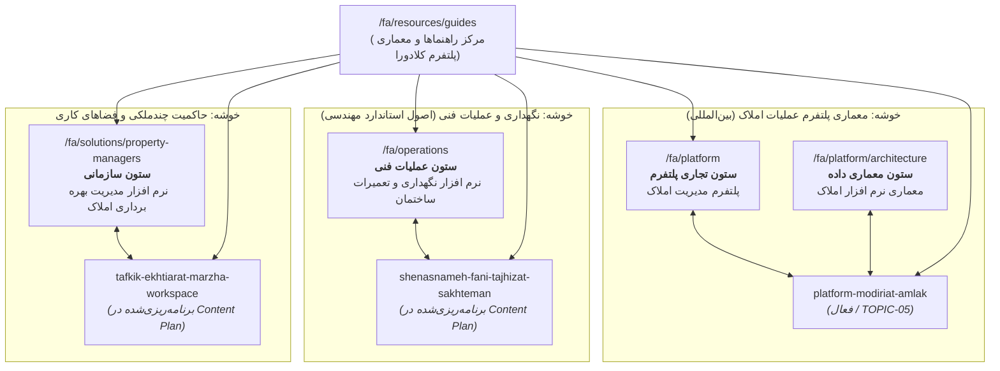

# نقشه جامع ارتباط کلیدواژه‌ها و اهداف جست‌وجو (Keyword-to-Intent) — زبان فارسی (FA)
## نسخه سند: 1.0 (مبتنی بر بسته بین‌المللی WP-15B)
## مخاطب هدف: سرمایه‌گذاران، مدیران و بهره‌برداران بین‌المللی فارسی‌زبان
## اصل بنیادین: تفکیک زبان از حوزه قضایی (عدم فرض ایران به‌عنوان کشور ملک)
## وضعیت حاکمیت: تاییدشده برای اجرا

---

## ۱. بیانیه راهبردی و تعریف جایگاه مخاطب فارسی‌زبان

بخش فارسی پلتفرم کلادورا به‌طور اختصاصی برای **مخاطبان بین‌المللی، فرامرزی و منطقه‌ای** طراحی شده است:
- **پرسونای اول: سرمایه‌گذاران و مالکان چندواحدی بین‌المللی**: مالکان و خانواده‌های سرمایه‌گذار فارسی‌زبان که در کشورهای مختلف (مانند امارات متحده عربی، ترکیه، کشورهای اروپایی، گرجستان و غیره) دارای سبد دارایی و واحدهای ساختمانی هستند و خواهان یکپارچگی سوابق دارایی‌ها بدون وابستگی به سامانه‌های جزیره‌ای محلی می‌باشند.
- **پرسونای دوم: مدیران بهره‌برداری و شرکت‌های مدیریت املاک مدرن**: اشخاص حقیقی یا حقوقی که مدیریت مجتمع‌های مسکونی لوکس، اداری یا تجاری را بر عهده دارند و نیازمند ابزارهای شفاف برای محاسبه سهم شارژ، نظارت بر تعمیرات و حفظ تاریخچه ساختمان هستند.
- **پرسونای سوم: مهندسان نگهداری و تاسیسات (Facility Management)**: متخصصان فنی که به دنبال استانداردسازی شناسنامه تجهیزات، برنامه‌ریزی نگهداری پیشگیرانه (نت) و صدور دستورکارهای فنی بر مبنای اصول جهانی مهندسی هستند.

### اصل بنیادین عدم فرض جغرافیایی (Jurisdiction Independence):
محتوای فارسی کلادورا به‌هیچ‌وجه فرض نمی‌کند که ملک فیزیکی در کشور ایران واقع شده است. در محیط عملیاتی، وضعیت Country Pack runtime برابر با `NOT_ACTIVE` و فعال‌سازی در وضعیت `NOT_RUN_NOT_PASS` است. الزامات کشور محل ملک باید جداگانه با منابع جاری و بازبینی واجد صلاحیت تأیید شوند؛ این محتوا فعال‌بودن Country Pack یا انطباق حقوقی تولیدی را اعلام نمی‌کند. تمرکز محتوا بر اصول معماری سیستم، مهندسی بهره‌برداری ساختمان، ثبت شفاف رویدادهای مالی و کنترل تفکیک‌شده اختیارات است.

---

## ۲. ماتریس تطبیق کلیدواژه با قصد جست‌وجو (Keyword-to-Intent Matrix)

| کلیدواژه اصلی (Primary Query) | عبارات پشتیبان (Secondary Queries) | قصد جست‌وجو (Search Intent) | نشانی مالک (Owner URL) | راهنماهای پشتیبان | مرحله قیف | پرسونای مخاطب | رفع تداخل (Cannibalization) |
| :--- | :--- | :--- | :--- | :--- | :--- | :--- | :--- |
| `پلتفرم مدیریت املاک` | نرم افزار مدیریت ساختمان، سامانه جامع املاک و مستغلات، نرم افزار جامع مدیریت مجتمع | تجاری / ارزیابی پلتفرم | `/fa/platform` | `platform-modiriat-amlak` | MOFU / BOFU | مدیران دارایی، مالکان مجتمع‌ها | صفحه فرود پلتفرم مالک قصد تجاری است؛ راهنماهای آموزشی مفاهیم را بسط می‌دهند |
| `معماری نرم افزار املاک` | معماری نرم افزار مدیریت ساختمان، مدل داده پایدار ملک، تفکیک سطوح پلتفرم | آموزشی / تحلیل معماری | `/fa/platform/architecture` | `platform-modiriat-amlak` | TOFU / MOFU | مهندسان نرم‌افزار، معماران سیستم، ارزیابان فنی | بررسی عمیق لایه‌های شش‌گانه کلادورا؛ ورود به جزئیات فنی بدون تداخل با صفحه اصلی پلتفرم |
| `پلتفرم عملیات و مدیریت املاک چیست` | مفاهیم بنیادین پلتفرم املاک، تفاوت نرم افزار سنتی شارژ با پلتفرم عملیاتی | آموزشی / آگاهی‌بخشی دسته‌بندی | `/fa/resources/guides/platform-modiriat-amlak` | `/fa/platform`, `/fa/platform/architecture` | TOFU | مالکان، مدیران ارشد، بهره‌برداران | مقاله مرجع دسته‌بندی موضوعی؛ تمرکز بر تبیین ساختار بدون ادعای فروش مستقیم نرم‌افزار |
| `نرم افزار نگهداری و تعمیرات ساختمان` | دستور کار تعمیرات ساختمان، ثبت خرابی مجتمع، شناسنامه فنی تاسیسات ساختمان | تجاری / ارزیابی راهکار فنی | `/fa/operations` | راهنمای برنامه‌ریزی‌شده: `shenasnameh-fani-tajhizat-sakhteman` | MOFU / BOFU | مدیران فنی، مهندسان تاسیسات | مالک قصد تجاری ماژول عملیات و نگهداری فنی املاک |
| `نرم افزار مدیریت بهره برداری املاک` | مدیریت پورتفولیو املاک، پلتفرم مدیریت چندین مجتمع، حاکمیت فضاهای کاری | تجاری / ارزیابی سازمانی | `/fa/solutions/property-managers` | راهنمای برنامه‌ریزی‌شده: `tafkik-ekhtiarat-marzha-workspace` | MOFU / BOFU | شرکت‌های مدیریت املاک، دفاتر سرمایه‌گذاری | راه‌حل تجاری مدیریت سبد املاک مستقل از مرزهای جغرافیایی |

---

## ۳. نمودار ساختار هاب و ستون‌های فارسی (FA Hub & Pillar Topology)

---

## ۴. برنامه محتوایی بین‌المللی فارسی (Content Plan)

برای جلوگیری از انتشار شتاب‌زده یا غیرمستند، مقالات فارسی جدید در قالب یک فرآیند فازبندی‌شده کنترل می‌شوند:

### فاز نخست (پایه جاری — تثبیت‌شده در WP-15A/B):
1. **`platform-modiriat-amlak`** (`TOPIC-05`): تبیین ساختار ۶ لایه پلتفرم عملیات، هویت پایدار ملک، فضاهای کاری مجزا و تفکیک ارائه‌دهندگان مرجع حقیقت داده‌ها (Active).

### فاز دوم (توسعه معماری و استانداردهای بهره‌برداری — در دست برنامه‌ریزی):
2. **`shenasnameh-fani-tajhizat-sakhteman`** (شناسنامه فنی و ثبت دارایی‌های فیزیکی ساختمان):
   - هدف: تشریح چرخه ثبت دارایی‌های مکانیکی، الکتریکی و ایمنی (HVAC، پمپ‌ها، ژنراتورها) بر اساس استانداردهای مهندسی ساختمان، بدون ارجاع به سامانه‌های بازرسی محلی کشوری خاص.
3. **`tafkik-ekhtiarat-marzha-workspace`** (مرزبندی فضاهای کاری و حاکمیت اختیارات زمان‌دار):
   - هدف: تشریح معماری دسترسی، اصل تفکیک شخص از نقش و اعطای اختیارات دارای سقف مالی در سبدهای ملکی چندمالکه.
4. **`modiriat-bahrebardari-amlak-chand-vahedi`** (اصول عملیاتی مدیریت بهره‌برداری و پایش داده‌های کنتور):
   - هدف: متدولوژی تفکیک مصارف مشترک و اختصاصی بر مبنای منطق ریاضی کنتورها، بدون مداخله در مقررات محلی مالیات.
