# CLADORA — Romanian SEO Content Cluster & Keyword-to-Intent Matrix
## Document Version: 1.0 (WP-15A Foundation)
## Market & Language: Romania / Romanian (ro)
## Governance Status: Approved for Implementation

---

## 1. Executive Summary & Mapping Principles

Acest document stabilește matricea canonică de asociere între intent-urile de căutare din piața din România și paginile CLADORA.

### Principii de Guvernanță:
1. **Unicitatea Owner URL (Zero Cannibalization)**: Fiecărui Primary Query îi este asociat un singur URL proprietar (Owner URL). Niciun alt articol sau pagină nu va folosi același H1 sau tag Title identic.
2. **Delimitarea Commercial Pillar vs. Informational Guide**: Paginile comerciale (`/ro/solutions/*`, `/ro/operations`) dețin interogările comerciale de produs / soluție. Articolele de suport dețin exclusiv interogările informaționale, metodologice, legale sau de calcul.
3. **Fără date fabricate**: Nu se inventează volume lunare de căutare sau scoruri arbitrare de „Keyword Difficulty”. Intent-urile sunt clasificate pe baza cerințelor statutare românești (Legea 196/2018, ISCIR, HG 273/1994) și a fluxurilor operaționale din teren.
4. **Claim Safety**: Nicio pagină nu promite automatizări garantate fără intervenție umană, certificări inexistente sau runtime-uri neactivate.

---

## 2. Keyword-to-Intent Master Matrix

| Cluster | Primary Query | Secondary Queries | Search Intent | Owner URL | Supporting URLs | Funnel Stage | Evidence / Statutory Source | Cannibalization Exclusions |
| :--- | :--- | :--- | :--- | :--- | :--- | :--- | :--- | :--- |
| **Cluster A** (Asociații) | `software administrare asociații de proprietari` | program administrare bloc, aplicație asociație proprietari, program administrator bloc, administrare condominiu, software listă întreținere | Commercial / Solution Evaluation | `/ro/solutions/associations` | Ghidurile 1-7 din Cluster A | MOFU / BOFU | Piața de administrare rezidențială din România; cerințele Legii 196/2018 pentru gestiunea asociațiilor | Niciun ghid de suport nu concurează pe termenul generic de soft de administrare |
| **Cluster A** (Asociații) | `legea 196 2018 asociatii de proprietari` | lege asociatie de proprietari, obligatii comitet executiv bloc, statut asociatie proprietari | Informational / Statutory Guidance | `/ro/resources/guides/asociatii-proprietari-legea-196-2018` | `/ro/solutions/associations`, `/ro/resources/guides/repartizare-cheltuieli-asociatie-proprietari`, `/ro/resources/guides/fond-rulment-vs-fond-reparatii` | TOFU | Legea nr. 196/2018 privind înființarea, organizarea și funcționarea asociațiilor de proprietari (legislatie.just.ro) | Nu vizează cumpărarea de soft; rol pur educativ și de conformare juridică |
| **Cluster A** (Asociații) | `repartizare cheltuieli asociatie proprietari` | criterii repartizare cheltuieli bloc, cheltuieli pe numar de persoane bloc, cheltuieli pe cota indiviza | Informational / Operational Procedure | `/ro/resources/guides/repartizare-cheltuieli-asociatie-proprietari` | `/ro/solutions/associations`, `/ro/resources/guides/program-calcul-intretinere-bloc`, `/ro/resources/guides/cota-parte-indiviza-calcul` | TOFU / MOFU | Legea 196/2018 Art. 75-85 (criteriile legale de repartizare) | Nu concurează cu pagina de produs; trimite utilizatorii către soluție |
| **Cluster A** (Asociații) | `program calcul întreținere bloc` | calcul întreținere asociație, algoritm calcul cote întreținere, soft calcul întreținere bloc | Informational / Workflow Evaluation | `/ro/resources/guides/program-calcul-intretinere-bloc` | `/ro/solutions/associations`, `/ro/resources/guides/lista-de-plata-asociatie-proprietari`, `/ro/resources/guides/cota-parte-indiviza-calcul` | MOFU | Legea 196/2018 Art. 75-82; analiza metodelor de calcul pe categorii de cheltuieli | Explică mecanismul matematic și algoritmul; diferit de pagina comercială de asociații |
| **Cluster A** (Asociații) | `listă de plată asociație proprietari` | model lista intretinere bloc, termen afisare lista intretinere, contestatie lista intretinere | Informational / Statutory Compliance | `/ro/resources/guides/lista-de-plata-asociatie-proprietari` | `/ro/solutions/associations`, `/ro/resources/guides/program-calcul-intretinere-bloc`, `/ro/resources/guides/fond-rulment-vs-fond-reparatii` | TOFU | Legea 196/2018 Art. 77-83; cerințe obligatorii de afișare și transparență | Concentrat pe formularul și conținutul legal al listei de plată, nu pe vânzarea platformei |
| **Cluster A** (Asociații) | `fond de rulment și fond de reparații` | fond rulment vs fond reparatii bloc, calcul fond de rulment asociatie, restituire fond rulment la vanzare | Informational / Financial Governance | `/ro/resources/guides/fond-rulment-vs-fond-reparatii` | `/ro/solutions/associations`, `/ro/resources/guides/asociatii-proprietari-legea-196-2018`, `/ro/resources/guides/cota-parte-indiviza-calcul` | TOFU | Legea 196/2018 Art. 71 (fond de reparații) și Art. 72 (fond de rulment) | Ghid de clarificare financiară; nu revendică termeni comerciali |
| **Cluster A** (Asociații) | `calcul cotă-parte indiviză` | cota parte indiviza formula, cota indiviza carte funciara, suprafata utila cota indiviza bloc | Informational / Mathematical Calculation | `/ro/resources/guides/cota-parte-indiviza-calcul` | `/ro/solutions/associations`, `/ro/resources/guides/repartizare-cheltuieli-asociatie-proprietari`, `/ro/resources/guides/program-calcul-intretinere-bloc` | TOFU | Legea 196/2018 Art. 2, Art. 75, Art. 85; Codul Civil Art. 648-659 | Focus strict pe calculul matematic și actele de proprietate (Cartea Funciară) |
| **Cluster A** (Asociații) | `migrare program administrare bloc` | schimbare program administrare bloc, preluare solduri asociatie de proprietari, import solduri program bloc | Commercial Consideration / Migration Procedure | `/ro/resources/guides/migrare-program-administrare-bloc` | `/ro/solutions/associations`, `/ro/resources/guides/asociatii-proprietari-legea-196-2018`, `/ro/resources/guides/lista-de-plata-asociatie-proprietari` | MOFU | Legea 196/2018, Legea contabilității 82/1991, OMFP 3103/2017 | Ghid tehnic de procedură pentru tranziție fără pierderi de date; susține onboarding-ul |
| **Cluster B** (Mentenanță) | `software mentenanță clădiri` | mentenanță preventivă clădiri, gestionare intervenții tehnice, sistem ticketing mentenanță, registru echipamente, ordine de lucru mentenanță | Commercial / Solution Evaluation | `/ro/operations` | Ghidurile 1-3 din Cluster B | MOFU / BOFU | Practicile tehnice de facility management din România; normative tehnice de siguranță | Niciun ghid tehnic nu folosește titlul comercial de software mentenanță clădiri |
| **Cluster B** (Mentenanță) | `mentenanță preventivă clădiri` | plan mentenanta preventiva cladire, revizii periodice instalatii cladiri, frecvente mentenanta tehnica | Informational / Technical Methodology | `/ro/resources/guides/mentenanta-preventiva-cladiri` | `/ro/operations`, `/ro/resources/guides/gestionare-interventii-tehnice-cladiri`, `/ro/resources/guides/registru-echipamente-revizii` | TOFU / MOFU | HG 273/1994 privind recepția construcțiilor, Normativ I7, ISCIR, Legea 10/1995 | Tratează metodologia de planificare preventivă, fără a pretinde statutul de pagină principală de soluție |
| **Cluster B** (Mentenanță) | `gestionare intervenții tehnice clădiri` | sesizari avarii bloc, tichete mentenanta cladiri, ordine de lucru instalatori | Informational / Workflow Architecture | `/ro/resources/guides/gestionare-interventii-tehnice-cladiri` | `/ro/operations`, `/ro/resources/guides/mentenanta-preventiva-cladiri`, `/ro/resources/guides/registru-echipamente-revizii` | MOFU | Standarde de operare în dispecerate de intervenții tehnice și mentenanță corectivă | Focus pe fluxul cap-coadă al biletului de avarie (raportare -> triaj -> execuție -> recepție) |
| **Cluster B** (Mentenanță) | `registru echipamente revizii` | fisa tehnica echipament cladire, evidenta revizii iscir lift centrala, carte tehnica instalatii cladire | Informational / Technical Registry | `/ro/resources/guides/registru-echipamente-revizii` | `/ro/operations`, `/ro/resources/guides/mentenanta-preventiva-cladiri`, `/ro/resources/guides/gestionare-interventii-tehnice-cladiri` | TOFU / MOFU | Prescripții Tehnice ISCIR (PT R1, PT R2, PT A1), HG 273/1994, Normativ P118 | Descrie structura datelor tehnice de activ și cerințele legale de conformare |
| **Cluster C** (Property Mgmt) | `property management software Romania` | software administrare proprietăți, administrare portofoliu imobiliar, management documente proprietăți, audit operațional imobile | Commercial / Solution Evaluation | `/ro/solutions/property-managers` | Ghidul 1 din Cluster C, ghidurile de arhitectură | MOFU / BOFU | Cerințele companiilor profesionale de administrare și operare de portofolii din România | Pagină dedicată soluției comerciale multi-proprietate |
| **Cluster C** (Property Mgmt) | `management documente proprietăți` | arhivare documente asociatie proprietari, cartea tehnica a constructiei digitala, provenienta documente imobiliare | Informational / Operational Governance | `/ro/resources/guides/management-documente-proprietati` | `/ro/solutions/property-managers`, `/ro/operations`, `/ro/resources/guides/registru-echipamente-revizii` | MOFU | HG 273/1994, Legea 196/2018 Art. 24, Legea 10/1995, GDPR (Regulamentul UE 2016/679) | Delimitează stocarea pasivă de evidențele operaționale imutabile de audit; nu revendică termeni generici de soft |

---

## 3. Hub & Pillar Architecture

```mermaid
graph TD
    Hub["/ro/resources/guides<br/>(Ghiduri & Resurse CLADORA)"]

    subgraph ClusterA ["Cluster A — Asociații de Proprietari"]
        PillarA["/ro/solutions/associations<br/><b>Pillar Comercial</b><br/>software administrare asociații de proprietari"]
        G1["asociatii-proprietari-legea-196-2018"]
        G2["repartizare-cheltuieli-asociatie-proprietari"]
        G3["program-calcul-intretinere-bloc"]
        G4["lista-de-plata-asociatie-proprietari"]
        G5["fond-rulment-vs-fond-reparatii"]
        G6["cota-parte-indiviza-calcul"]
        G7["migrare-program-administrare-bloc"]

        PillarA <--> G1
        PillarA <--> G2
        PillarA <--> G3
        PillarA <--> G4
        PillarA <--> G5
        PillarA <--> G6
        PillarA <--> G7
    end

    subgraph ClusterB ["Cluster B — Mentenanță & Operațiuni"]
        PillarB["/ro/operations<br/><b>Pillar Comercial</b><br/>software mentenanță clădiri"]
        G8["mentenanta-preventiva-cladiri"]
        G9["gestionare-interventii-tehnice-cladiri"]
        G10["registru-echipamente-revizii"]

        PillarB <--> G8
        PillarB <--> G9
        PillarB <--> G10
    end

    subgraph ClusterC ["Cluster C — Property Management & Documente"]
        PillarC["/ro/solutions/property-managers<br/><b>Pillar Comercial</b><br/>property management software Romania"]
        G11["management-documente-proprietati"]

        PillarC <--> G11
    end

    Hub --> PillarA
    Hub --> PillarB
    Hub --> PillarC
    Hub --> G1
    Hub --> G2
    Hub --> G3
    Hub --> G4
    Hub --> G5
    Hub --> G6
    Hub --> G7
    Hub --> G8
    Hub --> G9
    Hub --> G10
    Hub --> G11
```

---

## 4. Transparența Editorială & Proveniență

Toate articolele educaționale din aceste clustere sunt atribuite echipei:
- **Autoritate Editorială**: `Echipa de Cercetare & Arhitectură CLADORA`
- **Revizuire & Control Calitate**: `Echipa Editorială & de Cercetare CLADORA`
- **Profil Autor / Metodologie**: `/ro/resources/autori/cladora-research`
- **Politica de Corectitudine**: Actualizări periodice conform surselor oficiale consolidate (legislatie.just.ro).
- **Declinare de Responsabilitate**: Conținutul are scop informativ și arhitectural; nu constituie consultanță juridică, contabilă sau fiscală individualizată.
